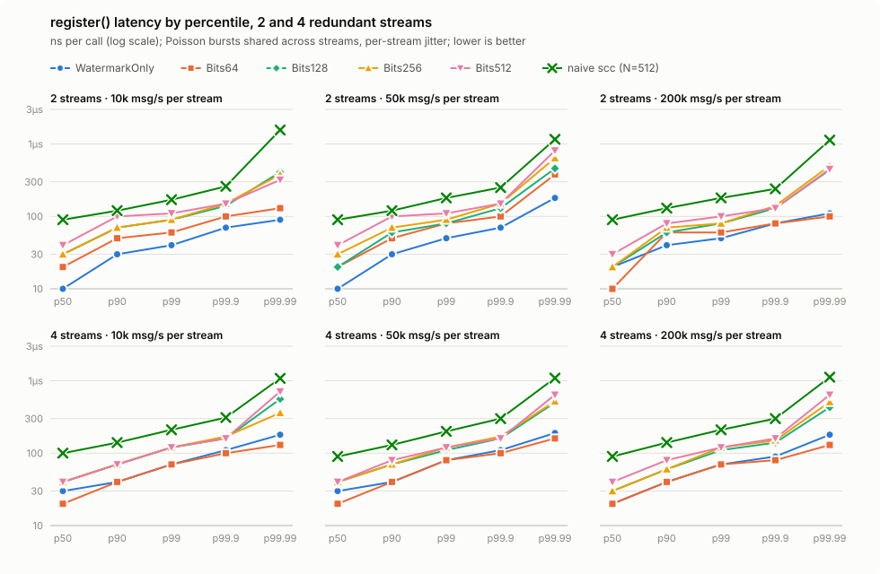
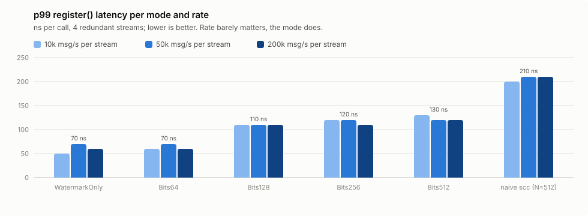

# seqdedupe

Lock-free deduplication of `u64` sequence numbers for a fixed set of threads
(x86-64 with `CX16`). Each thread holds a `Worker` and calls `register(seq)`.
The first call for a sequence number returns `New`, and every later call
returns `Duplicate`. A sequence number older than the retained window returns
`TooOld`.

```rust
use seqdedupe::{new_workers, Registration, Window};
use std::num::NonZeroUsize;

let mut workers = new_workers(Window::Last256, NonZeroUsize::new(2).unwrap(), 0, 0)?;
let mut b = workers.pop().unwrap();
let mut a = workers.pop().unwrap();
std::thread::scope(|s| {
    s.spawn(move || assert_eq!(a.register(5), Registration::New));
    s.spawn(move || { b.register(3); });
});
```

`Worker::snapshot()` returns the watermark and the sequence numbers still
missing from the window, both taken at the same logical instant.

## Build requirement: `cmpxchg16b`

`Last64` to `Last512` use a 128-bit `LOCK CMPXCHG16B`, written as inline
assembly so it can never fall back to a lock. That code is compiled only
when the target enables the `cmpxchg16b` feature, which the default
`x86_64` Rust target does not. Without it, `new_workers` returns
`InitError::MissingTargetFeature("cmpxchg16b")` for those modes; `Latest`
works either way.

**Applications using this crate must enable the feature themselves.** Target
features apply to the whole build, and Cargo ignores a dependency's own
`.cargo/config.toml`, so add one of these to your application:

```toml
# .cargo/config.toml in your application
[target.x86_64-unknown-linux-gnu]
rustflags = ["-C", "target-feature=+cmpxchg16b"]
# or a CPU level that includes it:
# rustflags = ["-C", "target-cpu=x86-64-v2"]   # or "native"
```

or set it per build: `RUSTFLAGS="-C target-feature=+cmpxchg16b" cargo build`.
The instruction is part of the `x86-64-v2` baseline. This repository's
own `.cargo/config.toml` sets the flag for its tests and benchmarks.

## Modes

| Mode | History kept below the watermark |
|---|---|
| `Latest` | None: a single `AtomicU64`. Anything at or below the watermark is `TooOld`. |
| `Last64` | 64 predecessors, stored inline in the 128-bit header. |
| `Last128` / `Last256` / `Last512` | N predecessors, stored in immutable preallocated slots. |

The library has no runtime dependencies. `new_workers_with(.., Tuning)`
exposes these tuning knobs:

- the header load instruction;
- a scalar or SIMD shift, including AVX-512 VBMI2;
- the `seq == high + 1` fast path;
- slot protection: `Optimistic` (the default) or `Hazard`;
- `reclaim_batch`, `pre_protect` and `recheck_before_cas`.

## Use cases

- **A/B feed arbitration.** Exchanges publish market data on redundant
  multicast feeds. Each feed-handler thread registers every packet. The
  thread that gets `New` processes the packet, and the others drop it. The
  faster feed wins each packet, with no lock and no arbiter thread.
- **Multi-path or replicated ingest.** Telemetry, IoT or trading events are
  replicated over several links, regions or UDP paths, so every receiver
  thread sees most messages more than once.
- **At-least-once consumers.** A Kafka or NATS consumer, or a retrying RPC
  client, gets messages redelivered after a timeout or failover. With a
  monotonic per-producer sequence, each message is processed exactly once,
  using bounded memory and no per-message allocation.
- **Gap detection.** `snapshot().missing()` lists the sequence numbers no
  feed has delivered yet. That list feeds a retransmission request or a
  snapshot recovery.
- **Fan-in of replicated logs.** Several replicas push the same entries, and
  each log index is applied exactly once.
- **Latest-value-wins streams (`Latest`).** For quotes or state
  updates, anything older than the newest message is stale anyway. This is
  the cheapest mode, but it reports both a duplicate and a late fill-in as
  `TooOld`.

**Choosing a window.** N must cover the worst reordering between feeds, in
messages: the maximum feed skew × the message rate. For example, feeds up to
2 ms apart at 200k msg/s are up to 400 messages apart, so use `Last512`. A
sequence number more than N behind the watermark is `TooOld`, even if it was
never seen.

## Latency under live-feed traffic

`benches/latency.rs` replays a simulated live feed through every mode, and
through `HashSet512`, a baseline built on `scc::HashSet` with the same
answers and a 512-message window (`benches/common/hashset.rs`).

- **Streams.** 2 or 4 redundant streams, each a pinned thread on its own
  physical core. Each stream delivers the same ids in order, at 10k, 50k and
  200k msg/s.
- **Bursts.** Messages arrive in bursts of geometric size (mean 8), and burst
  starts form a Poisson process. Every stream sees the same burst at the same
  message ids.
- **Per-stream timing.** Each stream reaches a burst after its own
  exponential delay (mean 2 µs). Within the burst, it spaces messages by its
  own exponential gaps (mean 1 µs).
- **Loss.** Each stream loses 1% of messages, and the other streams fill them
  in.
- **Measurement.** Each thread spins until a message is due, then times the
  `register()` call with `RDTSC` into an HDR histogram. Each configuration
  ran for 5 s on an EPYC 9845 (Zen 5c) with default tuning, giving 0.1–4 M
  samples.
- **Timer resolution.** On this CPU the TSC advances in 10 ns steps, and the
  timer's own cost (20 ns) is subtracted. An uncontended call reads as one
  step, shown as `<10`, and a two-step reading is shown as `<20`. Timing
  1000 calls together gives about 6 ns per uncontended call. Readings of
  50 ns and up span many steps and are barely affected.





All latencies are p50 / p99 / p99.9, in nanoseconds.

**2 streams**

| Mode | 10k msg/s | 50k msg/s | 200k msg/s |
|---|---|---|---|
| Latest | <10 / 40 / 70 | <10 / 50 / 70 | <10 / 60 / 80 |
| Last64 | <20 / 60 / 70 | <20 / 60 / 70 | <20 / 50 / 70 |
| Last128 | 30 / 90 / 140 | 30 / 80 / 130 | <20 / 80 / 130 |
| Last256 | 30 / 90 / 140 | 30 / 90 / 140 | 30 / 80 / 140 |
| Last512 | 40 / 110 / 150 | 40 / 110 / 140 | 30 / 100 / 120 |
| HashSet512 | 90 / 170 / 230 | 90 / 180 / 230 | 90 / 180 / 230 |

**4 streams**

| Mode | 10k msg/s | 50k msg/s | 200k msg/s |
|---|---|---|---|
| Latest | <20 / 70 / 100 | <20 / 80 / 100 | <20 / 70 / 90 |
| Last64 | 40 / 60 / 110 | 40 / 60 / 100 | 30 / 60 / 90 |
| Last128 | 40 / 120 / 160 | 40 / 110 / 160 | 30 / 110 / 150 |
| Last256 | 40 / 120 / 160 | 40 / 120 / 160 | 30 / 110 / 140 |
| Last512 | 40 / 110 / 150 | 40 / 120 / 150 | 40 / 120 / 150 |
| HashSet512 | 100 / 200 / 280 | 90 / 210 / 280 | 90 / 210 / 280 |

The `LastN` modes answer `New` for one delivery in S (50.5% with 2 streams,
25.25% with 4) and `Duplicate` for the rest. `Latest` answers `TooOld` for
35–37% of deliveries with 2 streams, and 55–58% with 4.

- **`LastN` vs `HashSet512`.** Every `LastN` mode is faster at every
  percentile, rate and stream count.
  - `Last512`, with the same 512-message window, is 2–3× faster at p50
    (30–40 vs 90–100 ns) and 1.5–1.8× faster at p99 (100–120 vs
    170–210 ns).
  - At p99.99 it takes 0.15–0.5 µs against 0.6–2.1 µs.
  - The baseline hashes, takes a bucket lock and touches a bucket line that
    another stream just wrote. A `LastN` mode needs one header load and at
    most one slot word.
- **2 vs 4 streams.** Doubling the streams adds up to 30 ns at p99 for
  `Last128`–`Last512`, at most 10 ns for `Last64`, and 30 ns for
  `HashSet512`. Each id is contended by more cores, so more header-line
  transfers happen and more CASes lose.
- **`Last64` vs `Last128`–`Last512`.**
  - The wider windows add 20–60 ns at p99, more with 4 streams. A duplicate
    behind the watermark must read a slot line that the winning stream just
    wrote on another core.
  - `Last64` keeps the history in the header line itself and reads it with
    a locked load, which keeps its p99 at 50–60 ns with 2 or 4 streams.
    Use it when 64 messages of reordering are enough.
- **`Last128` vs `Last256` vs `Last512`.** These are within 30 ns of each
  other at p99. A bigger window costs the extra cache line, not the shift.
- **`Latest` vs `Last64`.**
  - With 2 streams the latency is about the same. With 4, `Last64` has the
    higher p50 (30–40 vs <20 ns, the cost of its locked load) and the lower
    p99 (60 vs 70–80 ns).
  - `Latest` cannot tell "already seen" from "late and never seen". So when
    the fastest stream loses a message, the late fill-in from another stream
    is rejected.
  - That discards 0.6–0.7% of distinct messages. With 2 streams, `New` is
    50.14–50.16% of deliveries against 50.50% for the `LastN` modes; with 4,
    it is 25.10% against 25.25%.
- **Message rate.** Results are within 10–30 ns from 10k to 200k msg/s. At
  these rates, the streams rarely collide on the header CAS, so the latency
  is mostly cache-line transfers. A thread that sleeps between messages,
  instead of spinning, would also pay cold-cache misses.
- **Reproducibility.** p99.9 and below repeat within 10–40 ns between runs
  and seeds (the TSC resolution is about 10 ns). p99.99 and max vary by 2×
  or more (interrupts, SMIs), so treat them as orders of magnitude.

The raw data is in `bench-results/latency-epyc-9845.csv` (summary) and
`bench-results/latency-epyc-9845-curves.csv` (percentile curves).

## Building, testing and benchmarking

```sh
cargo test --release            # .cargo/config.toml enables cmpxchg16b

# Saturation throughput matrix (~10 min), or a quick subset
cargo bench --bench register
cargo bench --bench register -- --quick --only main --threads 1,4
# One configuration, for perf record
cargo bench --bench register -- --only main --threads 16 --targets Last512 --loads Dups --reps 3

# Live-feed latency, then the SVG charts
cargo bench --bench latency -- --rates 10,50,200 --streams 2,4 --secs 5 \
    --burst-mean 8 --gap-ns 1000 --jitter-ns 2000 --loss 0.01 --out bench-results/latency-HOST
python3 scripts/latency_charts.py bench-results/latency-HOST docs
```

Without `--out`, the latency benchmark writes `target/latency-HOST.csv` and
`target/latency-HOST-curves.csv`.

`scc` is a dev-dependency, used only by the baseline in the benchmarks and
tests.

## Further reading

- [`DESIGN.md`](DESIGN.md): constraints, invariants, design choices, and the
  testing and benchmarking methodology.
- [`BENCHMARKS.md`](BENCHMARKS.md): throughput under saturation, the
  contention analysis (including why `HashSet512` wins 16-thread
  lockstep duplicates on throughput), and the tuning experiments.

## License

MIT. See [`LICENSE`](LICENSE).
