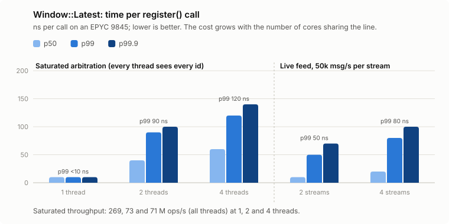
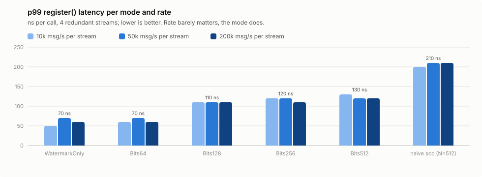
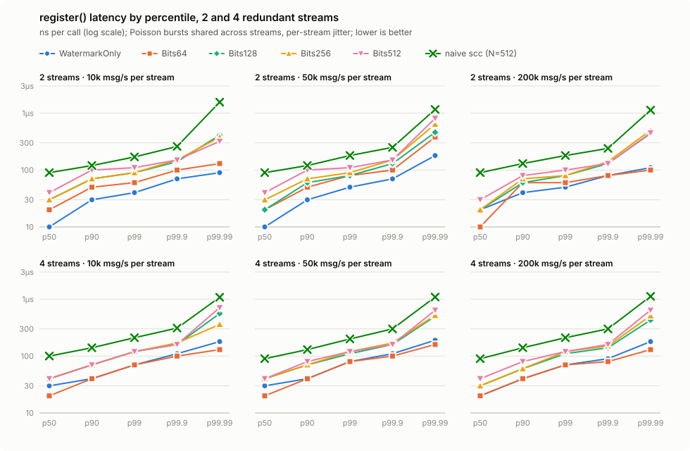

# Deduplicating redundant feeds without locks

*Draft. All numbers are from an AMD EPYC 9845 (Zen 5c) unless stated otherwise.*

**Contents:**

- [The problem, and the one-word solution](#the-problem-and-the-one-word-solution)
- [Remembering the tail with a hash set](#remembering-the-tail-with-a-hash-set)
- [128 bits are enough for 64 messages](#128-bits-are-enough-for-64-messages)
- [Moving the tail out of the header](#moving-the-tail-out-of-the-header)
- [Profiling, and what AVX-512 bought us](#profiling-and-what-avx-512-bought-us)
- [Closing thoughts](#closing-thoughts)

---

Many low latency ingestion systems rely on redundant data feeds deduplicating 
messages between streams to reduce the tail latencies. Sometimes ingestion
happens from multiple processes/multiple threads. Quite often data feeds 
provide contiguous sequence numbers for gaps detection purposes. 
When receiving message not seen before it should be processed exactly once,
ideally that is whichever thread got it first, with no lock and no single 
arbiter thread in the way.

In this post I walk through the designs I tried for this, from the simplest
to the one that ended up in [`seqdedupe`](../README.md). Starting with the simplest
solution, step by step improving on that.

### The problem and the `Latest` solution

Let's assume sequence numbers are contiguous `u64` and our API is:
```rust
enum Registration { 
    /// Never seen before
    New, 
    /// Duplicate message
    Duplicate, 
    /// Message is old and is outside dedupe memory, might be unseen
    TooOld 
}
trait Dedupe {
    fn register(&mut self, seq: u64) -> Registration;
}
```
For the harness close to reality we would assume feeds are reordered against each other
and occasionally lose a message, but messages arrival follows same distribution between 
feeds with correlated bursts.

The obvious first attempt is a single high watermark: an `AtomicU64` that
only moves forward.

```rust
impl Dedupe for Latest {
    fn register(&mut self, seq: u64) -> Registration {
        let mut cur = wm.load(Acquire);
        loop {
            if seq < cur { return TooOld; }
            if seq == cur { return Duplicate; }
            // NOTE: we might be detecting gaps here as well
            match wm.compare_exchange_weak(cur, seq, AcqRel, Acquire) {
                Ok(_) => return New,
                Err(v) => cur = v,
            }
        }
    }
}
```



The problem is every message that arrives behind the newest one is rejected, 
whether or not anyone processed it:

- In the live-feed simulation with 1% loss per feed, the late copies that
  should fill a gap are rejected. That drops **0.6–0.7%** of all distinct
  messages.

This design is the floor for the further improvements.

Digging on the tail spikes furter - with 4 threads in the arbitration workload it costs 
about 0.7 cache-to-cache line transfers per call:

```
$ perf stat -e cycles,instructions,L1-dcache-load-misses,ls_dmnd_fills_from_sys.local_ccx -- \
    register --only main --targets Latest --loads Dups --threads 4 --reps 3

       18140945121      cycles
       12543996369      instructions
          42423496      L1-dcache-load-misses
          27747011      ls_dmnd_fills_from_sys.local_ccx
```

`ls_dmnd_fills_from_sys.local_ccx` counts demand fills served by the L3 or by another core's L2 in the same CCX. 
The run makes 40 M `register` calls (5 passes × 4 threads × 2 M), so that is 0.69 cache-to-cache fills 
and 1.1 L1 misses per call.

**The harness notes**

- Each thread is pinned to its own physical core. It spins for 100 ms so the
  core reaches full clock, and then all threads start together from a
  spinning barrier.
- Each `register` call is timed with `lfence; rdtsc`. The samples go into 
  per-thread HDR histograms, which are merged afterwards.
- Timer resolution limits the smallest readings. The TSC runs at 2.1 GHz,
  but on this Zen 5c it advances in steps of 21 ticks, so a reading moves in
  10 ns steps. The empty `lfence; rdtsc` pair itself reads 20 ns, and that
  overhead is subtracted. An uncontended call then reads one step, shown as
  <10 ns; two steps are shown as <20 ns. Timing 1000 calls in a block gives
  the true cost: about 6 ns per call, the same as 1 / throughput. Tails
  and contended calls span many steps, so the ±10 ns quantization barely
  affects them.
- Throughput comes from a separate, untimed pass, and every run starts from
  a fresh deduper.
- The saturation workloads are:
  - **Seq:** every thread advances one watermark.
  - **Gaps:** random jumps forward.
  - **Late:** reordered within blocks of 16.
  - **Dups:** every thread sees every message.
- The live-feed simulation paces 2 or 4 streams at 10k–200k msg/s each, with
  Poisson bursts and 1% loss.

### Remembering the tail with a hash set

The watermark does not have memory and the textbook fix is a
bounded concurrent set of seen sequence numbers. A late arrival
counts as `New` if it is not in the set, and entries more than `N` below the
watermark are removed so the set stays bounded. I used
[`scc::HashSet`](https://crates.io/crates/scc) with a window of
`N = 64`, preallocated to `2N` entries; it is `HashSet64` below.

This fixes the correctness problem in our setting: no late fill-in is lost, as
long as it lands inside the window. But the cost now shifted to the tail latency.

In the tables, throughput comes from the untimed pass, all threads combined.
Mean and percentiles per call come from the timed pass, so they always
describe the same calls.

| | Latest | HashSet64 |
|---|---|---|
| Seq, 1 thread: M ops/s | 156 | 21 |
| Gaps, 1 thread: p50 / p99 per call | <10 / <10 ns | 50 / 2,300 ns |
| Dups, 2 threads: M ops/s, all threads | 73 | 13 |
| Dups, 2 threads: mean / p99 / p99.9 per call | 49 / 90 / 100 ns | 150 / 300 / 390 ns |
| Dups, 4 threads: M ops/s, all threads | 71 | 16 |
| Dups, 4 threads: mean / p99 / p99.9 per call | 59 / 120 / 140 ns | 220 / 820 / 1,530 ns |
| Dups, 2 threads: L1 misses / cross-core fills per call | 1.0 / 0.68 | 6.3 / 5.0 |
| Dups, 4 threads: L1 misses / cross-core fills per call | 1.1 / 0.69 | 7.4 / 6.0 |

> [!NOTE]
> The timer reads in 10 ns steps, so `<10 ns` means "one step or less" and
> `<20 ns` "two steps or less". An uncontended `Latest` call really takes
> about 6 ns (1 / 156 M ops/s).

Two very different things cause the tail.

**With one thread, it is the cleanup.** When the watermark jumps by `d`, the
thread that moved it must remove `d` old entries. Every entry is hashed (the default SipHash) 
and unlinked with a locked compare-exchange. Here is the hottest part of `HashSetWorker::register`:

```
 4.45 :  lock cmpxchg %rcx,0x38(%rbp)
 2.98 :  lock cmpxchg %rcx,0x38(%rbp)
 1.41 :  rol    $0xd,%rbx
 1.36 :  rol    $0x20,%rdx
 1.28 :  rol    $0x10,%rax
 1.22 :  rol    $0x11,%rbx
 1.16 :  rol    $0x15,%rax
 ...       (two dozen more rol/xor/add lines: SipHash rounds)
```

So the median call is 50 ns, but the call that happens to move the watermark
by 100 pays for 100 removals: 2.3 µs.

**With several threads, it is the locks.** `insert_sync` takes a per-bucket
lock, and waiting threads spin. In the 4-thread arbitration workload, 33% of
all cycles are in `saa::wait_queue::WaitQueue::spin_until` (10% with 2
threads); most of the remaining 19% is the benchmark loop itself:

```
  32.61%  saa::wait_queue::WaitQueue::spin_until
  26.98%  scc::hash_map::HashMap<K,V,H>::insert_sync
  13.57%  register::common::hashset::HashSetWorker::register
   2.24%  scc::hash_table::bucket::Writer<K,V,L,_>::lock_sync_wait
```

It is still a good concurrent hash map, but it is not lock-free, a preempted lock 
holder stalls everyone in its bucket, and a p99.9 of 1.5 µs with just 4 threads
is not what you want in a feed handler.

### 128 bits are enough for 64 messages

The set only needs to answer "which of the last 64 sequence numbers were
seen". That is a 64-bit mask. Together with the watermark it is 128 bits, and
x86-64 can compare-and-swap 128 bits atomically with `LOCK CMPXCHG16B`. So
the whole state fits in one atomic header, `{high, mask}`, where bit `i` of
`mask` means `high - 1 - i` was seen:

```rust
fn register(&mut self, seq: u64) -> Registration {
    let mut cur = header.load();
    loop {
        let Pair { lo: h, hi: m } = cur;
        let new = if seq > h {                 // advance: shift the history
            // NOTE: the gap detection would come here
            let d = (seq - h).min(65) as u32;          // shift amounts are u32
            let m = m.unbounded_shl(d) | 1u64.unbounded_shl(d - 1); // 0 once shift >= 64
            Pair { lo: seq, hi: m }
        } else if seq == h {
            return Duplicate;
        } else {                               // late arrival: set one bit
            let i = h - 1 - seq;
            if i >= 64 { return TooOld; }
            if m & (1 << i) != 0 { return Duplicate; }
            Pair { lo: h, hi: m | (1 << i) }
        };
        match header.cas(cur, new) {           // one LOCK CMPXCHG16B
            Ok(()) => return New,
            Err(v) => cur = v,
        }
    }
}
```

Two practical notes:

- **The CAS is inline assembly.** Stable Rust has no `AtomicU128`, and the
  usual workarounds compile a 16-byte CAS into a runtime-library call that
  may take a lock. So the CAS is a literal `lock cmpxchg16b`, compiled only
  when the target enables `cmpxchg16b`; otherwise initialization fails.
  The application turns it on in its `.cargo/config.toml`:

  ```toml
  [target.x86_64-unknown-linux-gnu]
  rustflags = ["-C", "target-feature=+cmpxchg16b"]
  ```
- **The header is read with a locked load.** A 128-bit `VMOVDQA` would also
  be atomic on AVX-capable CPUs and on one thread it is ~2× faster than `LOCK CMPXCHG16B`
  used as a load. But this design is for several threads, and here almost
  every load is followed by a CAS on the same line. The locked load holds
  the line for the whole read-modify-write instead of fetching it shared
  and then upgrading it for the CAS. With 2 and 4 threads in the
  arbitration workload it cuts the p99 from 90 and 160 ns to 40 and 50 ns,
  and the CAS retries on Seq by 6–20×, for 35% less throughput.

Compared with the hash set:

| Dups (arbitration) | HashSet64 | Last64 |
|---|---|---|
| 1 thread: M ops/s | 28 | 96 |
| 2 threads: M ops/s, all threads | 13 | 34 |
| 2 threads: mean / p99 / p99.9 per call | 150 / 300 / 390 ns | 39 / 40 / 50 ns |
| 4 threads: M ops/s, all threads | 16 | 35 |
| 4 threads: mean / p99 / p99.9 per call | 220 / 820 / 1,530 ns | 68 / 70 / 70 ns |
| 2 threads: L1 misses / cross-core fills per call | 6.3 / 5.0 | 1.3 / 1.0 |
| 4 threads: L1 misses / cross-core fills per call | 7.4 / 6.0 | 1.4 / 1.0 |

> [!NOTE]
> The timed pass puts about 20 ns of timer and histogram work between
> calls, which lowers contention. Back to back, a 4-thread `Last64` call
> takes 114 ns (4 / 35 M ops/s), against a timed mean of 68 ns. The
> live-feed simulation below paces the calls like a real feed.

In the Gaps workload, p99 drops from 2.3 µs to <20 ns, because a jump is
just a shift. Compared with the plain watermark, the 64-bit history costs
about 0.3 extra cache-to-cache fills per call. In the live-feed simulation,
`Last64` and `Latest` are within 20 ns of each other at p99 and p99.9. With 4
streams `Last64` has the higher p50 (30–40 vs <20 ns, the locked load) and
the lower p99 (60 vs 70–80 ns).

The limit is 64 messages. At 200k msg/s, that covers only 320 µs of skew
between feeds.

### Moving the tail out of the header

To keep more history, the bits have to live outside the 128-bit atomic. The
header becomes `{high, slot_id}`, and the bitmap lives in a preallocated,
cache-aligned slot of 128, 256 or 512 bits (512 bits is exactly one cache
line). Three rules keep it lock-free:

- **Slots are immutable once published.** A writer never edits the current
  slot. It copies the history into a free slot it owns, applies the shift or
  sets the late bit, and publishes it by CASing the header. The replaced slot
  goes back to the writer's own pool. This is old-fashioned double buffering:
  I/O systems were filling one buffer while the program consumed the other
  back in the 1960s and 70s. If you wrote games for the ZX Spectrum, you
  drew the next frame off-screen and swapped it in for the same reason.
- **Header values never repeat.** Slots are recycled, so a slot id alone
  could come back when only bitmask changes and high stays during sequence of 
  updates. To rule this out, the second header word holds `slot_id | late_updates << 32`.
  Every successful CAS either raises `high` or, at the same `high`, raises
  `late_updates` by one.
- **Reads are validated optimistically.** A slot read is trusted only if the
  header is unchanged afterwards, as in a seqlock. For an update, the CAS
  does that check. For a `Duplicate`, the thread reloads the header.

The indirection costs one dependent cache line per call. `Last64` from the
previous chapter is the baseline: its whole state is one AtomicU128, with no
slot to follow.

| | Last64 | Last128 | Last256 | Last512 | HashSet512 |
|---|---|---|---|---|---|
| History | in the AtomicU128 | 128-bit slot | 256-bit slot | 512-bit slot (L1 line) | `scc::HashSet` entries |
| Seq, 1 thread: M ops/s | 75 | 99 | 93 | 89 | 21 |
| Dups, 1 thread: M ops/s | 96 | 166 | 154 | 141 | 28 |
| Dups, 2 threads: M ops/s, all threads | 34 | 42 | 42 | 32 | 14 |
| Dups, 2 threads: mean / p99 per call | 39 / 40 ns | 55 / 120 ns | 54 / 110 ns | 62 / 120 ns | 143 / 280 ns |
| Dups, 4 threads: M ops/s, all threads | 35 | 28 | 33 | 35 | 18 |
| Dups, 4 threads: mean / p99 per call | 68 / 70 ns | 95 / 210 ns | 90 / 220 ns | 88 / 170 ns | 205 / 570 ns |
| Live feed, 4 streams: p99 per call | 60 ns | 110–120 ns | 110–120 ns | 110–120 ns | 200–210 ns |

Last512 makes 1.9 L1 misses and 1.5 cross-core fills per call with 2
threads, and 2.9 and 2.4 with 4, against 1.3 / 1.0 and 1.4 / 1.0 for
Last64. The extra misses come from reading a slot line that the winning
thread has just written on another core, and the profile shows exactly
that. Last512 with 4 threads, in address order:

```
 10.32 :  je     ...                     ← first branch on the header value
  0.26 :  vmovdqu64 0x0(%rbp),%zmm0      ← load the current slot
 15.84 :  cmp    $0x1,%r12               ┐ the slot-line miss, charged to the
 15.73 :  jne    ...                     ┘ instructions waiting for it
 18.22 :  lock cmpxchg16b (%rdi)
```

A third of the samples wait for the slot line, 18% are the CAS and 10% wait
for the header line.

The window size barely matters: Last128, 256 and 512 are within 30 ns of
each other in the live-feed test. The cost is the extra cache line, not the
width of the shift.

The hash set goes the other way: `HashSet512` is slightly faster than
`HashSet64` under contention (4 threads: 18 vs 16 M ops/s, p99 570 vs 820 ns;
8 threads: p99 1.4 vs 2.5 µs). This might be attributed to more buckets would
imply less contention.



The weak spot is several threads advancing the same watermark at full
speed (Seq). With 4 threads, the slot modes drop to 9–10 M ops/s with a
p99 of 0.85–1.0 µs, and every call retries its CAS 2.6–2.9 times: the window
between reading the header and the CAS (read the slot, write the new one) is
long enough for another thread to get in. Last64 holds 35 M ops/s with a
p99 of 50 ns. With 2 threads the gap is smaller: 18–25 vs 34 M ops/s.

### Profiling, and what AVX-512 bought us

The first version of the slot modes used hazard pointers instead of
optimistic validation, and shifted the 512-bit history with eight scalar
`SHLD`s. It ran Seq at 75 M ops/s on one thread. The top lines of
`perf annotate`:

```
 12.24 :  lock cmpxchg16b (%rdi)
 11.62 :  push   %r14            ┐
  6.30 :  push   %rbp            │ function prologue: most likely skid
  6.25 :  push   %r13            │ from the call and the stores of the
  5.84 :  push   %r15            ┘ previous iteration
  1.81 :  shld   $0x1,%rdx,%rdi  ┐
  1.75 :  shld   $0x1,%rdx,%rdi  │
  ...                            │ eight dependent SHLDs: about 13%
  1.42 :  shld   $0x1,%rdx,%rdi  ┘
  1.18 :  xchg   %r8,%rbx
```

That led to two changes.

**1. Drop the hazards.** Once the header was ABA-free, the optimistic
validation described above became sound. It needs no `XCHG`, no hazard
array and no reclamation scans. That alone gave +12–13% on one thread and
cut the 4-thread Seq p99 by 43–62%.

**2. Shift the whole history in one register.** With AVX-512 VBMI2, all 512
bits fit in one `zmm` register. A masked `VPERMQ` does the 64-bit word
shift, `VALIGNQ` fetches each lane's lower neighbour, and `VPSHLDVQ` does
the funnel shift across lanes. The bit for the old watermark is ORed in
without leaving the register:

```rust
let a   = _mm512_loadu_si512(src);
let idx = _mm512_sub_epi64(_mm512_set_epi64(7, 6, 5, 4, 3, 2, 1, 0), _mm512_set1_epi64(q));
let hi  = _mm512_maskz_permutexvar_epi64((0xff << q) as u8, idx, a);   // word shift
let lo  = _mm512_alignr_epi64::<7>(hi, _mm512_setzero_si512());       // lower neighbours
let v   = _mm512_shldv_epi64(hi, lo, _mm512_set1_epi64(r));            // bit shift
let bit = _mm512_maskz_set1_epi64(1 << (k / 64), 1 << (k % 64));       // old watermark
_mm512_storeu_si512(dst, _mm512_or_si512(v, bit));
```

That is one aligned load and one store. The scalar version needed two
unaligned loads that crossed into a guard word.

After both changes, the CAS takes 41% of the samples in the same function,
and no vector instruction is above 1%:

```
 41.25 :  lock cmpxchg16b (%rdi)
  2.33 :  cmpl   $0x1,0x48(%rbx)
  ...
  0.80 :  vmovdqu64 %zmm0,(%rax)
  0.72 :  valignq $0x7,%zmm3,%zmm0,%zmm1
```

Last512 before → after, both measured with the current code by switching
the two options (M ops/s, all threads; p99 per call):

| | 1 thread | 2 threads | 4 threads |
|---|---|---|---|
| Seq | 75 → **89** | 16 → 19 (p99 280 → 180 ns) | 7.9 → 9.1 (p99 2.1 → **1.0 µs**) |
| Gaps | 64 → **82** | 20 → 26 | 14 → 12 (p99 1.6 → **0.9 µs**) |
| Dups | 123 → **142** | 34 → 39 | 32 → 32 (p99 260 → **180 ns**) |

Most of the gain is from dropping the hazards. Seq on one thread goes 75 M
ops/s with hazards and the scalar shift, 81 with hazards and VBMI2, 85 with
optimistic validation and the scalar shift, and 89 with both. With 2 or 4
threads, throughput varies by about ±20% between runs, so only the p99
improvements are clearly above noise. There the shift no longer shows up in
the profile at all: what is left is the slot line, the CAS and the header
line from the previous chapter.

In the live-feed simulation, the final Last512 is 2–3× faster than the
hash set at p50 and 1.5–1.8× faster at p99, with 8× the history of Last64:



### Closing thoughts

Each step put the state a decision needs on fewer cache lines, or changed
the shared line less often:

- The watermark is one line, but it forgets too much.
- The hash set remembers everything, but touches about 6 lines per call and
  takes locks.
- The 128-bit header fits 64 messages of history into the same single line.
- The slot design pays one extra line for 8× the history.

What remains in every profile is the `CMPXCHG16B` and the cache-line
transfer behind it, which SIMD cannot remove. Getting past it needs a
different design: combining several updates into one CAS, or keeping the
newest 64 bits inline and spilling only older history into slots. That is a
topic for a future post.

*All of this was measured on AMD. I would like to see the numbers from a
recent Intel part, where `CMPXCHG16B` and cross-core transfers have
different costs. If you spot a mistake or have a better idea, please let me
know.*
